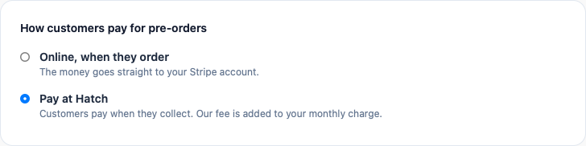
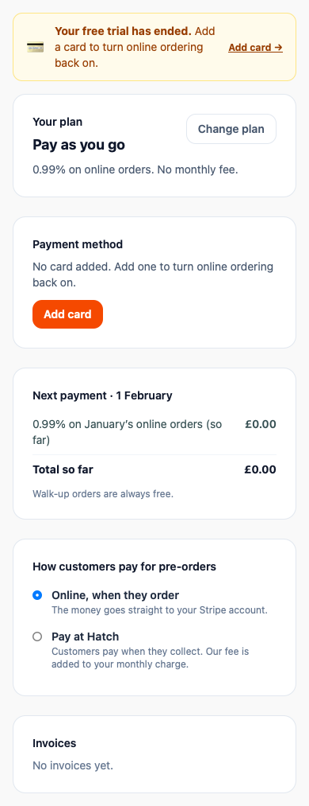
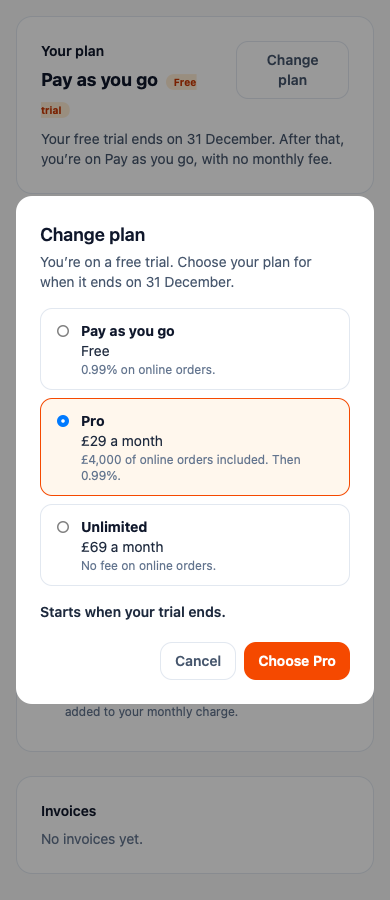

# billing-3: notice F, choosing a plan during the trial, Pay at Hatch wording, the Stripe run

*11 November 2026. Work commit `b9b13b65`; migration commit `280fd2e3`. Rules followed:*
- *`billing_enabled` stays **false** (checked, §8).*
- *Nothing was deployed.*
- *Pizzeria Gusto was not touched, tested against or queried (§7).*
- *No landing-page changes and no `outreach_templates` rows.*
- *No `.env*` file was opened, read or printed. The Stripe key was loaded by Next's own loader (`@next/env`), as the billing-1 report describes.*
- *The test script refuses any key that does not start with `sk_test_`.*

## Summary

| Check | Result |
|---|---|
| `node scripts/billing-1-stripe-test.cjs` (Stripe **test mode**) | **26 passed, 0 failed** (billing-1's 14 + 12 new) |
| `node scripts/billing-1.cjs` | **131 passed, 0 failed** |
| `node scripts/billing-2.cjs` | **72 passed, 0 failed** |
| `node scripts/billing-3.cjs` (new) | **51 passed, 0 failed** |
| `node scripts/messages-parity.cjs` | 1,001,970 passed, 0 failed |
| `translation-check.cjs`, all 36 language bases | 0 structural problems |
| `scripts/languages-world-1-rtl.cjs` | 111 passed, 0 failed |
| `split-messages.cjs --check` | the catalogue matches (121 namespaces) |
| `tsc --noEmit` | clean |
| `scripts/billing-3-screens.cjs` (WebKit, 390 and 1280) | 8 screenshots, no sideways scroll |

**One real bug found and fixed (§5.4):** a plan upgrade made after a plan's end date had passed never took effect.

## 0 · Flags

- **No span of the prompt arrived garbled.**
- **No instructions contradicted each other.**
- **Another session (pricing-copy-1) was editing the same message, back-translation and harness files at the same time.**
  - My commit contains only my keys.
  - Each shared file was checked to equal HEAD plus billing-3's keys and nothing else.
  - Their untracked `docs/pricing-copy-1/` was left alone.
- **Back-translation files.** My first apply step re-sorted the whole of each back file.
  - The contents were right, but every line moved.
  - I rebuilt each file in HEAD's own key order, so the diff is now only the six billing-3 lines per language.

## 1 · The Stripe test run (test mode)

`node scripts/billing-1-stripe-test.cjs` → **26/26**. This is billing-1's 14 checks plus the billing-2 flows:

| Flow | What it proved |
|---|---|
| Checkout set-up | It opens a `cs_test_…` session in setup mode with a Stripe URL. The session carries the truck's id. It is not complete until a card is entered. |
| Hosted invoice "Pay now" | The invoice's hosted page answers 200 at `invoice.stripe.com`. |
| Invoice PDF | The PDF downloads. Stripe serves it as `application/octet-stream`, so the check reads the `%PDF-` bytes, not the header. |
| The 5-day pause instant | Online ordering is paused at 00:00 after 5 full days, on Stripe's real failure. It turns back on after a good card pays. |
| Smart Retries | See below. |
| The retry fallback | See below. |

### Do Smart Retries apply to our one-off invoices? **Yes.**

- **After Stripe's own first attempt:** I moved a test clock forward 16 days. Stripe retried the one-off, auto-advancing invoice by itself 9 times.
- **After a payment attempt we start** (the owner's "Pay now", or the engine's charge): within seconds Stripe scheduled its next retry (`next_payment_attempt`, about 2 days later).

**What I built (billing-2 §6 point 3) is therefore a fallback only.** The hourly run retries an unpaid invoice itself **only when Stripe has no retry scheduled**. That happens if Smart Retries are switched off in the Dashboard, or the invoice stopped auto-advancing.

The fallback's rules:
- It never retries on the day of the failure.
- It retries once per local day, from 08:00 the truck's time.
- It stops after 16 days.
- Each day's attempt carries the idempotency key `billing:retry:<invoice>:<day>`, so an hourly re-run cannot charge twice.

The test proved each rule:
- With Stripe's retry still scheduled, the run answers "waiting for Stripe" and does nothing.
- With retries switched off (simulated), it does not retry on the failure day or before 08:00, and it retries at 09:00.
- A second run the same day leaves the Stripe charge count unchanged (4 → 4).
- The next day, on a good card, the invoice is paid and the truck is active.

**One small edge case:** a manual "Pay now" can fail on a later day just before an hourly run. In the few seconds before Stripe schedules its retry, the run can make **one** extra attempt that day. This is harmless and at most once a day.

**Code:**
- `lib/billing/engine.ts`: `retryUnpaidInvoices` (called by `runBillingAll` before late fees) and `RETRY_FOR_DAYS = 16`.
- `lib/billing/processor.ts`: `ProcessorInvoice.nextPaymentAttempt`, and an idempotency key on `payInvoice`.

**Left in Stripe test mode:** the run's test customers, invoices and one test clock under fresh owners. They are harmless, and can be deleted in the Dashboard under test mode.

## 2 · Pay at Hatch wording

- **Title:** the second choice in "How customers pay for pre-orders" is now the existing localised word `PRICE_WORD.payAtHatch` ("Pay at Hatch"). The old `tab.preorders.atTruck` key was removed in every language.
- **Hint:** "Customers pay when they collect. Our fee is added to your monthly charge."



Phone: [pay-at-hatch-card-390.png](billing-3/pay-at-hatch-card-390.png). Whole page: [390](billing-3/pay-at-hatch-390.png) · [1280](billing-3/pay-at-hatch-1280.png).

### What happens to Pay at Hatch when the truck chose "Online, when they order" (billing switched on)

- **During the free trial:** customers are offered **both** Pay at Hatch (if the truck's plan allows it, as today) and paying online by card.
  - Trial orders are not counted, so no fee is charged on them.
- **After the trial:** Pay at Hatch is **not offered**. Customers pay by card online.
  - Our fee comes out of that card payment, as it does now.

For comparison, when the truck chose **"Pay at Hatch"**:
- After the trial, Pay at Hatch is the way customers pay.
- It is only offered while the truck has a valid card on file and is not paused.
- Our fee on those orders is **added to the monthly invoice**, the "monthly charge" the hint mentions.

While billing is off (today), none of this applies: the existing rule is unchanged.

## 3 · iOS

As you accepted from billing-2 §0.2, the iOS app shows no buy buttons and no billing notices. This covers the new parts too:
- Notice F is hidden on iOS, through the same `purchaseCtaAllowed()` check as A–E.
- So is the Payment method card's new "Add one to turn online ordering back on" line.
- So is the Change plan button.

## 4 · Notice F, "Your free trial has ended."

- **Words:** "**Your free trial has ended.** Add a card to turn online ordering back on." **Link:** "Add card →".
- **Behaviour:** not dismissible. It uses the same notice strip and rules as A–E.
- **When it shows:** the trial is over and there is no valid (or pending) card.
- **Priority:** E → D → **F** → B → A → C. A payment failure or pause outranks it.
- **Payment method card in that state:** "No card added. Add one to turn online ordering back on." with **Add card**.



Desktop: [trial-ended-1280.png](billing-3/trial-ended-1280.png)

## 5 · Choosing a plan during the trial

### 5.1 What the owner sees

- **Change plan** now shows during the trial and opens the same window.
- The line under the title: "You’re on a free trial. Choose your plan for when it ends on {date}."
- The selected plan shows "**Starts when your trial ends.**" There is no charge now and no amount box.
- The button reads "**Choose {plan}**".
- After choosing, the plan card's trial line ("Your free trial ends on {date}. After that, you’re on …") names the chosen plan and its price.

The window as rendered (390px):

> Change plan | You’re on a free trial. Choose your plan for when it ends on 31 December. | Pay as you go · Free · 0.99% on online orders. | **Pro** · £29 a month · £4,000 of online orders included. Then 0.99%. | Unlimited · £69 a month · No fee on online orders. | Starts when your trial ends. | Cancel | Choose Pro



Desktop: [trial-change-plan-1280.png](billing-3/trial-change-plan-1280.png)

**Note, not changed:** at 390 the plan card's small "Free trial" badge wraps onto a second line, behind the window. This is billing-2's existing layout. It is not new, and I left it alone.

### 5.2 How it is stored

- **New column:** `truck_billing.trial_end_plan_key`. It is nullable and references `plans(key)` (migration below).
- **No choice made** (NULL) means the country's trial-end plan, exactly as before.
- **Choosing during the trial** stores the choice and clears any pending plan change.
- **Nothing is charged** at the time of choosing.
- **When the trial ends:**
  - `effectivePlan` (`lib/plans.ts`) ends the trial into the chosen plan, if it is active, public, not a trial, and has a price in the truck's country. Otherwise it uses the country's fallback, as today.
  - The hourly run then sets `trucks.plan` to it (`applyTrialEndChoice`).
  - The month's first charge is billed from the end of the trial. The harness checks the Pro example: 1450 for the rest of the month.
- **Server:** `change_plan` returns the updated view during the trial. It refuses (400) only if the truck has no trial end date.

### 5.3 Harness coverage

`scripts/billing-3.cjs` checks:
- the choice is stored;
- nothing is charged at choosing;
- the trial line names the chosen plan;
- the trial ends into it, with the right charge;
- `applyTrialEndChoice` moves `trucks.plan` and clears the end date.

### 5.4 Bug found and fixed: changes after a plan's end never took effect

**The problem:**
- `trucks.trial_expires_at` is the end date of whatever plan the truck is on.
- When a truck upgraded, or a held downgrade applied, after that date had passed, `setTruckPlan` changed the plan but left the old end date.
- `effectivePlan` therefore still saw an expired plan and returned the fallback. The truck was charged for the upgrade but stayed on the old plan.

**The fix:**
- `setTruckPlan` takes `clearPlanEnd`.
- The upgrade, held-downgrade and trial-end paths pass it when the end date has passed.

**Proof:**
- A billing-3 check upgrades after a plan end: 1967 is charged and the plan takes effect.
- Mutation test: forcing "plan end passed" to false makes 4 checks fail.

## 6 · Translations

Six strings are new or changed: `notices.trialEnded`, `tab.payment.noneAfterTrial`, `changePlan.trialLine`, `changePlan.startsAtTrialEnd`, `changePlan.choose` and `tab.preorders.atTruckHint`. One was removed: `tab.preorders.atTruck`.

- **Coverage:** all are in en-GB and all 36 language bases, with back-translations in `docs/i18n/back/`.
- **Regenerated:** the per-namespace `messages/ns/*/billing.json` files.
- **Checks:** 0 structural problems, parity passes, and RTL (ar-AE, he-IL) passes.

Translators' notes worth knowing:
- **hu-HU:** the button is "Választás: {plan}" ("Choice: {plan}"). Hungarian would otherwise need the plan name inflected.
- **Slavic languages, ar-AE and de-DE:** the button puts a noun before the placeholder for the same reason. Examples: "Wybierz plan {plan}", "Избор на {plan}", "Tarif {plan} wählen".
- **de-DE:** the trial line is correct but a little formal ("…für die Zeit nach ihrem Ende am {date}").
- **Lines that put the date first:** some languages (hu-HU, pl-PL, ja-JP) put the date before the choice. The meaning is the same.
- **is-IS:** "turn back on" is rendered as "opna aftur".
- **bg-BG:** uses Bulgarian quotation marks where quotes appear.

## 7 · Pizzeria Gusto

Gusto was not queried, touched or tested against. Two things show that it sees nothing new:
- **Code:** every new path runs only when billing is on, or for a `billing_test` truck. The trial-end choice is NULL for every truck: no rows are set (§8).
- **Harness:** a Gusto-shaped truck with the switch off gets the identical view and gate, and `runBillingAll` is skipped.

`scripts/billing-1-db-read.cjs` was **not** run, because it reads Gusto's gate.

## 8 · SQL run

The migration was committed first (`280fd2e3`), then run with `scripts/db-migrate.cjs` in one transaction, with no error:

```sql
-- supabase/migrations/20261090_billing_3_trial_plan.sql
begin;
alter table public.truck_billing add column if not exists trial_end_plan_key text references public.plans(key);
commit;
```

Read-only checks:

```sql
select c.conname, c.contype, pg_get_constraintdef(c.oid) from pg_constraint c join pg_class t on t.oid=c.conrelid where t.relname in ('plans','truck_billing') and c.contype in ('p','u','f') order by 1;
select column_name, data_type, is_nullable, (select count(*) from truck_billing where trial_end_plan_key is not null) as set_rows, (select billing_enabled from platform_switches) as billing_enabled from information_schema.columns where table_name = 'truck_billing' and column_name = 'trial_end_plan_key';
-- → text, nullable, 0 rows set, billing_enabled = false
```

No other SQL was run.

## 9 · Files

**Code:**
- `lib/plans.ts`
- `lib/billing/`: `engine.ts`, `view.ts`, `store.ts`, `store-types.ts`, `memory-store.ts`, `processor.ts`
- `app/api/manage/billing/route.ts`
- `components/manage/BillingScreen.tsx`

**Harnesses:**
- `scripts/billing-3.cjs` (new, registered in `harnesses.json`).
- `scripts/billing-3-screens.cjs` (new, run by hand, registered as a server harness like billing-2's).
- `scripts/billing-1-stripe-test.cjs` (the billing-2 flows, Smart Retries and the retry fallback).
- `scripts/billing-1.cjs` and `scripts/billing-2.cjs`: the "change plan during the trial" checks were updated to the new behaviour.

**Strings:** `messages/*.json` (37), `messages/ns/*/billing.json` (37) and `docs/i18n/back/*.json` (36).

**Screenshots:** `docs/billing-3/`.

## Undo (only if Dominic asks)

```sql
begin;
alter table public.truck_billing drop column if exists trial_end_plan_key;
commit;
```

Code: `git revert b9b13b65 280fd2e3`.
