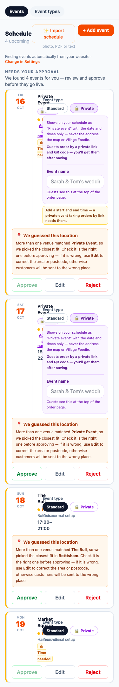
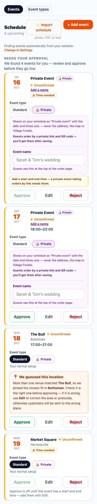
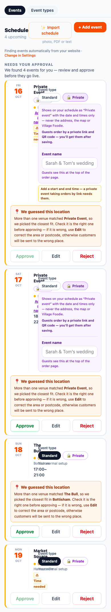
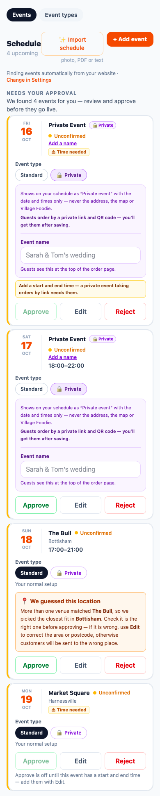
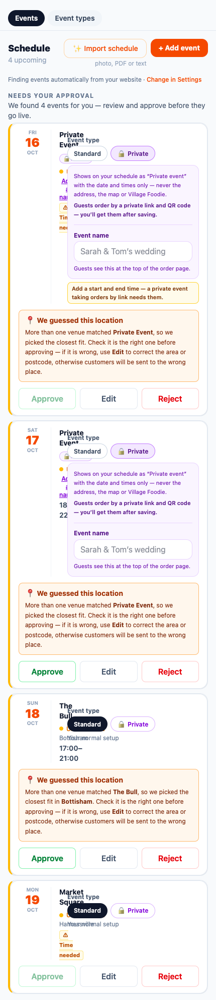
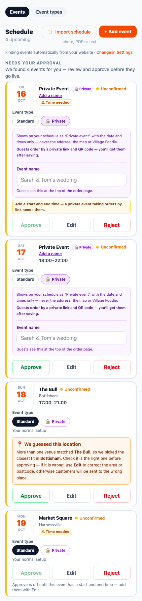
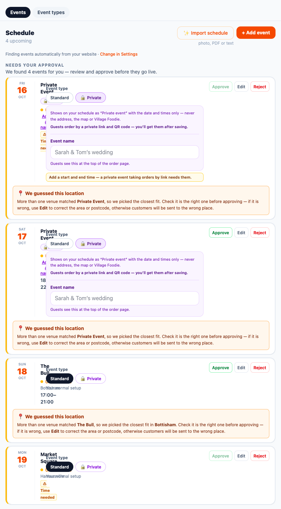
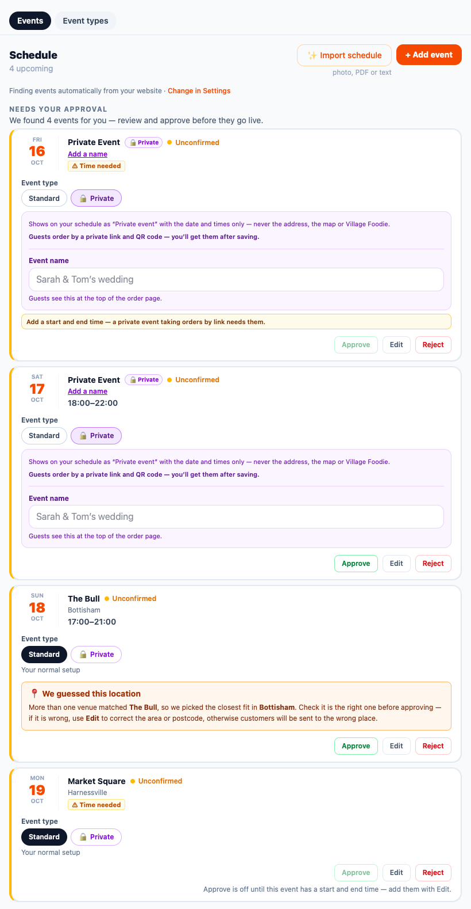
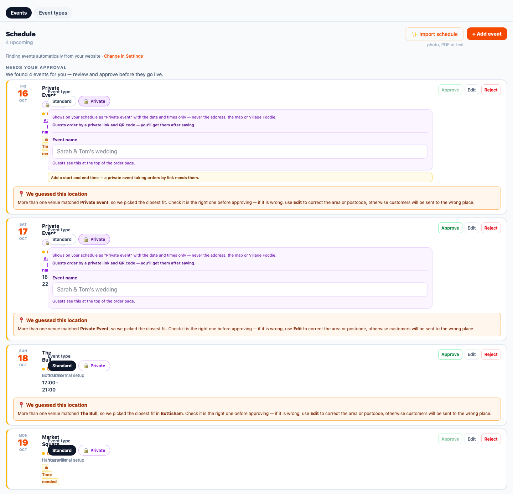
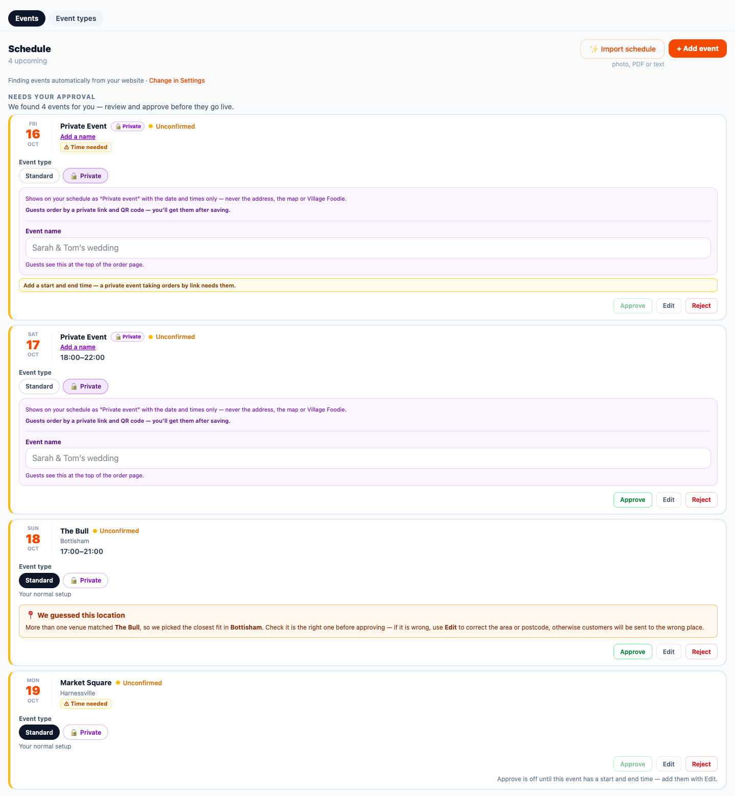

# Fix — the pending-event card overlaps on phones, and private events get a pointless location guess

**Reported by Dominic, live, on his phone:** Manage › Schedule › "Needs your approval" for Pizzeria Gusto.

**Status:** fixed and proven on fixtures only (Pizza Kitchen). Gusto's rows were READ, never changed. Nothing is committed, pushed or deployed.

**Data fix:** SQL is given below, **NOT RUN**.

**Garbled spans or contradictions:** none.

---

## 1 · Diagnosis

### 1a · Why the Event type chooser covered the card
The pending card is built by `renderEvent` in `app/manage/[token]/page.tsx`.

**Its main row was a horizontal flex** (`flex items-start gap-4`) holding:
- the date column (`w-12`);
- a divider;
- the details column (`flex-1 min-w-0`: title, private chip, status, "Add a name", "⚠ Time needed", address);
- **the Event type chooser** (`<div className="mt-3 w-full">`);
- a desktop-only copy of Approve / Edit / Reject (`hidden sm:flex`).

A `w-full` item inside a flex row takes the whole row, and `min-w-0` lets the details shrink to nothing.

**Measured in WebKit:** the details column was **0 px wide at every width, 320 px to 1440 px**. On a phone its text (the "Private Event" title, the badges, the "Time needed" note) spilled out underneath the chooser, which is exactly what Dominic saw.

The BEFORE pictures (§3) show it. `scripts/pending-card-render.cjs` failed 128 checks on the old card.

### 1b · How "Private Event" became a venue search (read-only, Supabase MCP)
**Gusto's pending rows** (three, not one — 14, 15 and 16 October):

```sql
select e.id, e.event_date, e.status, e.source, e.venue_name, e.address, e.venue_address, e.postcode, e.town, e.start_time, e.end_time,
       e.venue_id, e.venue_id_source, e.venue_match_confidence, e.truck_place_id, e.event_type_id, e.is_private, e.private_name,
       (e.private_token is not null) as has_token, e.scraped_signature, e.latitude, e.longitude, e.created_at
from public.truck_events e
where e.truck_id = 'pizzeria-gusto' and e.event_date between '2026-10-14' and '2026-10-20' order by e.event_date;
```

| date | status | source | venue_name | times | venue_id | venue_id_source | confidence | is_private | event_type_id | lat, lng | postcode / town |
|---|---|---|---|---|---|---|---|---|---|---|---|
| 14 Oct | unconfirmed | scraper | Private Event | none | d89a7a76… | scraper | low | **true** | null | 55.378051, −3.435973 | null / null |
| 15 Oct | unconfirmed | scraper | Private Event | none | d89a7a76… | scraper | low | **true** | null | 55.378051, −3.435973 | null / null |
| 16 Oct | unconfirmed | scraper | Private Event | none | d89a7a76… | scraper | low | **true** | null | 55.378051, −3.435973 | null / null |

All three have `scraped_signature` "Private Event", no token and no private name, and were created on 13 October 2026.

**The venue they point at:**

```sql
select * from public.venues where id = 'd89a7a76-ff97-464e-91d1-4329daa94bf3';
```

→ **name "Private Event"**, village null, postcode null, latitude 55.3780510, longitude −3.4359730, country GB, created 22 May 2026. Those coordinates are **the geographic centre of the United Kingdom** — what a geocoder answers for "UK" when it has nothing else. It is a junk row: a title that was once written down as a place.

**The path:**
1. Gusto's schedule lists the booking as "Private Event", with no place and no time.
2. The Apps Script email bridge posts it to **`app/api/inbound-schedule/route.ts`**, which passes `row.venue_name` ("Private Event") to **`findVenue`** (`lib/venue-matcher.ts`).
3. `findVenue` matched it **exactly by normalised name** to the junk "Private Event" venue. With no village to check against, it stamped **`venue_match_confidence = 'low'`**.
4. The bridge wrote `venue_id`, `venue_id_source = 'scraper'` and the centre-of-UK coordinates onto the event.
5. Manage shows "📍 We guessed this location — More than one venue matched **Private Event**…" for any unconfirmed scraper event with low confidence. It never asked whether the event was private.

The bridge's own privacy test (`scrapedPrivacyFields`: the word "private" in the found text) had already marked the rows `is_private = true`. Nothing told the venue match to stand down.

**Where the junk venue came from:** the discovery gate (`lib/discovery-gate.ts`) and the scraper (`scripts/run-scraper.js`) both create a venue for a name they don't recognise. Neither knew that a title such as "Private Event" names no place.

### Generic-named venues (read-only)
```sql
select v.id, v.name, v.village, v.postcode, round(v.latitude,4) lat, round(v.longitude,4) lng, v.created_at::date as created,
  (select count(*) from public.truck_events e where e.venue_id=v.id) as truck_events,
  (select count(*) from public.truck_events e where e.venue_id=v.id and e.event_date >= current_date) as truck_events_future
from public.venues v
where v.name ~* '^\s*(private|tbc|tba|tbd|event|events|closed|wedding|party|booked|n/?a|unknown|various|see website|location tbc|venue tbc|function|corporate)\y'
order by truck_events desc, v.name;
```
(Plus a `discovery_events` count per venue.)

| venue | village / postcode | lat, lng | created | truck_events (future) | discovery_events | generic? |
|---|---|---|---|---:|---:|---|
| **Private Event** | — / — | 55.3781, −3.4360 (UK centre) | 22 May | **3 (1)** — all Gusto's | 0 | **yes** |
| **Private Party** | Cambridge / CB2 1TN | 52.2053, 0.1218 | 22 May | 0 | 0 | **yes** |
| **Corporate Lunch** | Haverhill / CB9 7XF | 52.0684, 0.4740 | 8 Sep | 0 | 0 | **yes** |
| Party In The Park | Clare Castle Country Park | 52.0759, 0.5819 | 2 Jun | 1 (0) | 2 | no — a real event title |
| Corporate Party For @Uk Power Network | Stratford | — | 8 Sep | 0 | 0 | no — specific |
| TBC Black Dog Music Project | Norwich / NR3 4DY | 52.6510, 1.3093 | 8 Sep | 0 | 0 | no — a real project name |

**Events whose own title is generic:**

```sql
select venue_name, count(*) n, count(*) filter (where venue_id is not null) with_venue,
  count(*) filter (where is_private) private_n, min(event_date), max(event_date)
from public.truck_events
where venue_name ~* '^\s*(private|tbc|tba|tbd|closed|private (event|party|hire|booking|function))\s*$'
group by venue_name;
```

| venue_name | events | with a venue | private | dates |
|---|---:|---:|---:|---|
| "Private Hire" | 6 | 0 | 0 | 27 Jun – 8 Oct |
| "Private Event" | 3 | 3 | 3 | 14–16 Oct |

All 9 rows are Gusto's.

### 1c · Why Approve looked greyed out
It **was disabled**, not a style issue: `disabled={!event.start_time || !event.end_time}`.
- Gusto's scraped private events have no times, and the server refuses to confirm an event without them (`event_needs_times` / `private_needs_times`).
- The only explanation was a `title` tooltip, which a phone never shows.
- So on a phone the button simply looked grey and dead, with the "⚠ Time needed" note behind the chooser.

---

## 2 · The fix

### 2.1 · The card's layout (`app/manage/[token]/page.tsx`, `renderEvent`)
**The order is now the same at every width:**
1. the details (date, title, badges, address/area, notes);
2. the Event type chooser, in normal flow at the card's full width;
3. the warnings (private times prompt, guessed location, no location, conflicts);
4. **one** Approve / Edit / Reject row — full-width buttons on a phone, compact and right-aligned from 640 px.

The duplicate desktop-only button block inside the main row is gone. It was the second thing squeezing the details. The card's words are unchanged, apart from the one sentence in 2.4.

### 2.2 · Private events need no location
- **No location boxes for a private event.** Neither "We guessed this location" nor "No location yet" shows for a private event. "Private" means what the chooser says (`privateNow`): switching it to Private hides the boxes at once, and switching back to Standard brings back the normal behaviour. Before the types load, the event's own flag decides.
- **Approve never waits on a location.** The server's confirm never required one. The Edit form ("Approve" routes there when times are missing) used to require a venue name for every event; it now does not when Private is chosen (`formPrivate`, the same test the save uses).
- **The venue stays optional, for the truck's reference only, and is never shown to guests** (unchanged).
- **The times rule is unchanged:** a private event taking orders by link still needs a start and end time, both on the card and on the server.

### 2.3 · A generic title is never matched as a venue, for every event type
**Where the guard lives:** `lib/venue-matcher.ts` now has `isGenericVenueName(name)`, and `findVenue` returns no venue for a generic name, even when a venue row of that exact name exists.
- The list is in `lib/generic-venue-names.json`, one place: Private / Private event(s) / party / hire / booking / function / catering, Corporate event / lunch, Closed, TBC, TBA, TBD, Venue/Location TBC/TBA, Event(s).
- It matches the **whole name, normalised**, so "Party In The Park" and "TBC Black Dog Music Project" still match.

**What reads it:**
- **The email bridge** (`/api/inbound-schedule`, the path that produced Gusto's guess) and the **discovery gate** both call `findVenue`, so both are covered.
- **The discovery gate** no longer creates a venue from a generic title.
- **`scripts/run-scraper.js`** no longer writes one either; it reads the same JSON file.

**And a private scraped event gets no venue guess at all.** In the bridge, `scrapedPrivacyFields(...)` is now asked before the insert: a private row is inserted with no venue, no coordinates, no postcode from a venue, and no confidence. Duplicate detection is unchanged.

### 2.4 · Approve says why it's off
When Approve is disabled for lack of times, the card now says, in plain words under the buttons: **"Approve is off until this event has a start and end time — add them with Edit."**
- This is the new message `manageSchedule.card.approveNeedsTimes`. It reads the same in the US, so there is no en-US override.
- For a private event the existing purple-panel prompt ("Add a start and end time — a private event taking orders by link needs them.") already says it, so the new sentence isn't shown twice.

### Files
**Product code:**
- `app/manage/[token]/page.tsx`;
- `lib/venue-matcher.ts`, `lib/generic-venue-names.json` (new), `lib/discovery-gate.ts`;
- `app/api/inbound-schedule/route.ts`;
- `scripts/run-scraper.js`.

**Messages:** `messages/en-GB.json` (one new key), with the generated catalogue.

**New harnesses** (registered in `scripts/harnesses.json`): `scripts/pending-card-render.cjs`, `scripts/generic-venue-guess.cjs`.

**Re-pinned harnesses:**
- `scripts/_lp2-named.cjs`, `_lp2-checks.cjs`, `_lp1d-named.cjs`, `_lp1d-checks.cjs`, `_lp1d2-named.cjs`, `_lp1d2-checks.cjs`;
- `scripts/schedule-graphics-places.cjs`, `scripts/screenshot-truck-details.cjs`;
- `scripts/fixtures/language-phase-2-us-changed.txt` (regenerated; one row's cause updated).

**Screenshots:** `docs/screenshots/pending-card/{before,after}-{375,390,430,820,1440}.png`.

---

## 3 · Proof

### Screenshots, BEFORE | AFTER
They are rendered in WebKit (the iPhone's engine) from the real ScheduleTab with the app's compiled CSS, using Pizza Kitchen fixtures. The four cards are:
1. a private event with no times and Gusto's junk "guessed" venue;
2. the same with times;
3. a standard event at a really-guessed venue (The Bull, Bottisham);
4. a standard event with no times.

BEFORE comes from a clean worktree of commit `826471a`, so it is the unfixed card.

| width | BEFORE | AFTER |
|---|---|---|
| 375 |  |  |
| 390 |  |  |
| 430 |  |  |
| 820 (iPad) |  |  |
| 1440 |  |  |

### `scripts/pending-card-render.cjs` — AFTER 276 passed, 0 failed · BEFORE 160 passed, 128 failed
At **320, 375, 390, 430, 820 and 1440 px**, for every card, it **measures**:
- the chooser's box does not intersect the details' box, and sits below them;
- the details are at least 120 px wide and their text is not clipped;
- nothing sticks out past the card;
- the chooser spans the card's width;
- exactly one visible Approve, after the chooser;
- any warning comes before Approve;
- the page never scrolls sideways.

**The fixture behaviour it checks:**

| fixture | result |
|---|---|
| Private, no times | no location box; Approve disabled; the card says why |
| Private, with times | no location box; **Approve enabled — never blocked by location** |
| Standard, guessed venue | the guessed box is shown, byte-identical to before |
| Standard, no times | Approve disabled, and the new sentence is shown |

**Fixture correction:** the fixture's page padding was first 12 px against Manage's real 16 px. That made the sticky Events/Event types bar (`-mx-4`) stick out by 4 px. It was a fixture artefact; the fixture now uses the page's real padding, and BEFORE was re-taken with it.

### `scripts/generic-venue-guess.cjs` — 33 passed, 0 failed
It runs the real modules and routes on the in-memory database:
- "Private Event", "Private party", "Private Hire", "Private booking", "Private function", "Closed", "TBC", "TBA", "T.B.C.", "Event" are generic; "Party In The Park", "TBC Black Dog Music Project", "Red Lion", "Privateer Brewery", "Closed Shop Cafe", "The Private Bar" are not.
- `findVenue` returns no venue for those generic titles even when a venue row of that exact name exists ("Private Event" at the UK centre, as live). It still matches "Red Lion" (high) and "Party In The Park" exactly as before.
- The discovery gate creates no "Private Event" or "TBC" venue, and still creates "Village Green".
- **The bridge:**
  - "Private Event" goes in private, with no venue, coordinates, confidence or postcode.
  - **"TBC" (a non-private, standard event) gets no venue matched by its title.**
  - "Red Lion" is matched exactly as before: venue, coordinates, postcode, `scraper`, high.
- The scraper and the matcher read the one list.

### Everything else
- **Language harnesses:** messages-parity **23,350**, messages-split **135**, ui-literals pass; language-phase-0 **168**, 1a **1,050**, 1b **3,522**, 1c **4,498**, 2 **1,124**, 1d **308**, 1d2 **485**.
- **Product harnesses:** private-events **206**, event-types **192**, schedule-graphics-places **270**, places-tab **98**, places-posts-gating **48**, schedules-country-parity **73**, screenshot-truck-details **174**, us-readiness **50**.
- **Every UK word and screen outside the card is unchanged.** The language harnesses prove each Schedule view byte-identical outside the pending card, with the card's words identical apart from the one new sentence (§4).
- **`npx tsc --noEmit`:** clean. **`next build`:** exit 0.
- **ESLint** per rule against HEAD: no rule count grew in any product file (page, venue-matcher, discovery-gate, inbound-schedule, run-scraper). The two new harnesses have only `no-require-imports`, as every CommonJS harness does.
- **Full harness sweep** (`node scripts/run-harnesses.cjs`), run at the end on the final tree: **127 run · 127 passed · 0 failed**, exit 0. It includes the two new harnesses.

## 4 · Re-pinned harnesses (each marked `⚠️ RE-PINNED (pending-card fix, 16 Oct 2026)`)
**language-phase-2, -1d and -1d2: one named change, `pending-card-layout`, proven once** (`pendingCardProof` in `_lp2-named.cjs`).
- With every pending card cut out of both BEFORE and AFTER, the rest of the view is **byte-identical**. Card counts and each card's opening tag must also match.
- Each card's text is compared as a multiset, and must equal BEFORE except:
  - the new sentence, exactly when Approve was disabled and no private prompt was shown;
  - the removed duplicate desktop buttons (each word must still be on the card);
  - a location box disappearing **only** on a private card.
- AFTER must have exactly one Approve, with the same disabled state and title.
- It catches nine deliberate breakages (a word changed inside or outside the card, a box removed from a public card, the sentence wrongly added or missing, a dropped Reject, a wrongly disabled Approve, the desktop block re-added, pending markup outside a card).

**schedule-graphics-places:**
- The six lost lines are excused one by one: the two location-box conditions as named edits, and the four lines of the removed desktop block in a counted list.
- A companion check requires the desktop block gone and the single action row present.

**screenshot-truck-details:** the fix is added as a fifth named later build, with the exact added and removed lines claimed.

**⚠️ Stated plainly:**
- The card proof compares text, not DOM order; the reorder is deliberate, and `pending-card-render.cjs` covers the layout.
- The language-harness captures have no private or no-times pending card, so those branches are proven by the new harness and the re-pin's own deliberate breakages, not by the old captures.
- 1d's US Schedule views stay listed under `1d-us-address-style`, as before.

---

## 5 · Junk venues — SQL for Dominic, **NOT RUN**
Nothing was deleted or changed.

**Gusto's three pending events need no data fix to look right.** After this deploys, the card hides the location box for a private event, and Approve then waits only on times. The SQL below is clean-up.
- **Detaching** removes a fake pin at the centre of the UK from the three events.
- **Removing** the three generic venues means no old code path can match them again.

**1 · Read-only check — run first** (expected: Private Event with 3 truck events, Private Party 0, Corporate Lunch 0, and 0 discovery events each):
```sql
select v.id, v.name, v.village, v.postcode, v.latitude, v.longitude,
  (select count(*) from public.truck_events e where e.venue_id = v.id) as truck_events,
  (select count(*) from public.discovery_events d where d.venue_id = v.id) as discovery_events
from public.venues v
where v.id in ('d89a7a76-ff97-464e-91d1-4329daa94bf3',   -- Private Event
               '0b40f7bc-52a9-4fbc-a589-e36051e1fbed',   -- Private Party
               '27bc422d-632b-4c7c-a398-b9af34e1de17');  -- Corporate Lunch
```

**2 · The fix — NOT RUN** (one transaction, with backups):
```sql
begin;
create table public.generic_venues_backup_20261016 as
  select * from public.venues
  where id in ('d89a7a76-ff97-464e-91d1-4329daa94bf3','0b40f7bc-52a9-4fbc-a589-e36051e1fbed','27bc422d-632b-4c7c-a398-b9af34e1de17');
create table public.generic_venue_events_backup_20261016 as
  select id, venue_id, venue_id_source, venue_match_confidence, latitude, longitude
  from public.truck_events
  where venue_id in (select id from public.generic_venues_backup_20261016);
create table public.generic_venue_discovery_backup_20261016 as
  select id, venue_id from public.discovery_events
  where venue_id in (select id from public.generic_venues_backup_20261016);

-- detach the events; clear coordinates only where they ARE the junk venue's own (never an operator's)
update public.truck_events e
set venue_id = null, venue_id_source = null, venue_match_confidence = null,
    latitude  = case when e.latitude  = v.latitude  and e.longitude = v.longitude then null else e.latitude  end,
    longitude = case when e.latitude  = v.latitude  and e.longitude = v.longitude then null else e.longitude end
from public.generic_venues_backup_20261016 v
where e.venue_id = v.id;
update public.discovery_events set venue_id = null
where venue_id in (select id from public.generic_venues_backup_20261016);

-- remove the generic venues (nothing points at them now)
delete from public.venues where id in (select id from public.generic_venues_backup_20261016);

-- check before committing: expect 0 and 0
select count(*) from public.truck_events where venue_id in (select id from public.generic_venues_backup_20261016);
select count(*) from public.venues where id in (select id from public.generic_venues_backup_20261016);
commit;
```

**3 · Rollback — NOT RUN** (only if needed):
```sql
begin;
insert into public.venues select * from public.generic_venues_backup_20261016 on conflict (id) do nothing;
update public.truck_events e set venue_id = b.venue_id, venue_id_source = b.venue_id_source,
  venue_match_confidence = b.venue_match_confidence, latitude = b.latitude, longitude = b.longitude
from public.generic_venue_events_backup_20261016 b where e.id = b.id;
update public.discovery_events d set venue_id = b.venue_id
from public.generic_venue_discovery_backup_20261016 b where d.id = b.id;
commit;
-- once you are happy, the three backup tables can be kept or dropped by you.
```

**Notes:**
- The `venues` table has no "active" column, so "deactivate" is not available. Removal is the only option, with the backup above.
- "Party In The Park", "Corporate Party For @Uk Power Network" and "TBC Black Dog Music Project" are left alone: they are specific names, not generic ones.

## 6 · Worth knowing
1. **The "We guessed this location" wording** says "More than one venue matched…". For Gusto's rows only one had matched; confidence is also 'low' when there is one candidate and no village to confirm it. The words are unchanged here (the brief said no change to what the card says), but they could be made truer later.
2. **The card's location boxes follow the chooser**, so they also hide while an operator has Private selected for a public event they haven't saved yet. That is the behaviour asked for ("switching the chooser to Private hides the box immediately").
3. **Gusto's six older "Private Hire" events** (June–October) carry no venue and need nothing.
